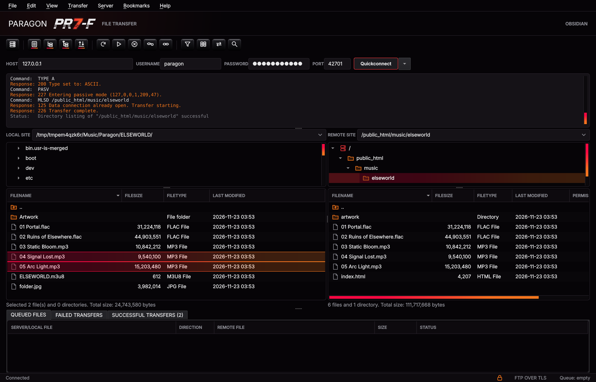

# Paragon PR7-F

The Paragon family's file transfer program: it works the way **FileZilla** works and wears the family's look
(Paragon PR7-Z, PR7-W, PR7-L, the PR7 plugins).

## What it does (0.3.0)

- **Protocols, with FileZilla's defaults**: FTP using **explicit TLS when the server offers it** (plain otherwise),
  TLS required or implicit (ftps://, port 990) when chosen; **SFTP** (sftp://, or port 22 in the quick-connect bar)
  with a password or a key file. New host keys and unknown certificates are shown and asked about, as FileZilla does.
- **The window**: quick-connect bar with recent servers, message log, local and remote sites (folder tree over file
  list), transfer queue (queued / failed / successful) with a progress bar, speed and time left; padlock and
  "FTP OVER TLS" / "SFTP" in the status bar.
- **Transfers**: double-click a file, drag between the panes (or from Explorer), or Upload / Download / Add to queue
  from the right-click menu; folders included; 2 at once (Settings); FileZilla's "Target file already exists" question
  (overwrite, if newer, if different size, resume, rename, skip; for all); lost connections retried twice; resume.
- **Files**: create directory, rename, delete (local: to the Recycle Bin), file permissions (chmod), copy URLs,
  **View/Edit** (opens a server file with its program and offers to upload it when you save it).
- **Directory comparison** and **synchronised browsing**.
- **Directory listing filters** (Ctrl+I) per side, **quick search** (Ctrl+F) and **Search remote files** (F3).
- **Bookmarks** (Ctrl+B): global or per site, local and remote folder, synchronised browsing and comparison.
- **Site Manager** (Ctrl+S): saved sites with FileZilla's choices. Passwords are kept in **Windows Credential
  Manager**, never in a file.

## Install

Download `PR7-F-Setup-x.y.z.exe` from the latest build (Actions > build > artifacts) or a release. It installs for
your user only (no admin rights).

## Develop

    pip install -r requirements.txt -r requirements-dev.txt
    python -m pr7f [folder | ftp://user@host]
    python -m pytest                  # starts real FTP, FTPS and SFTP servers on 127.0.0.1
